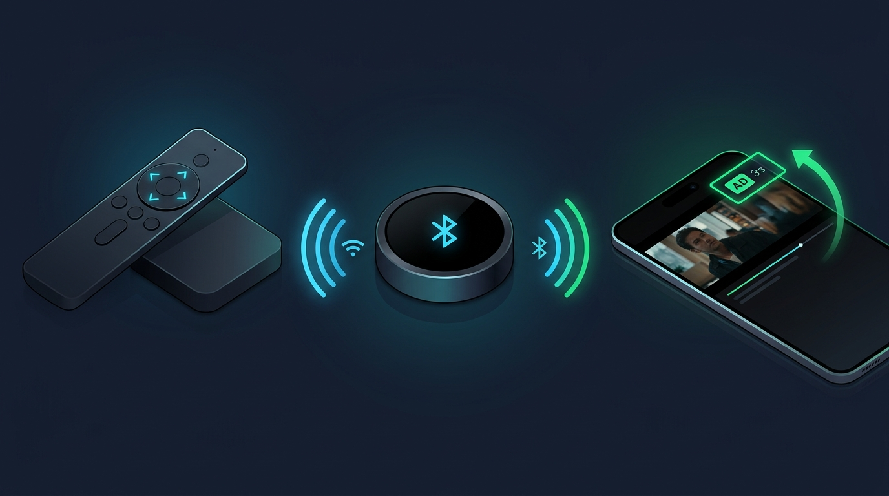
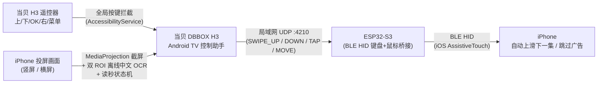
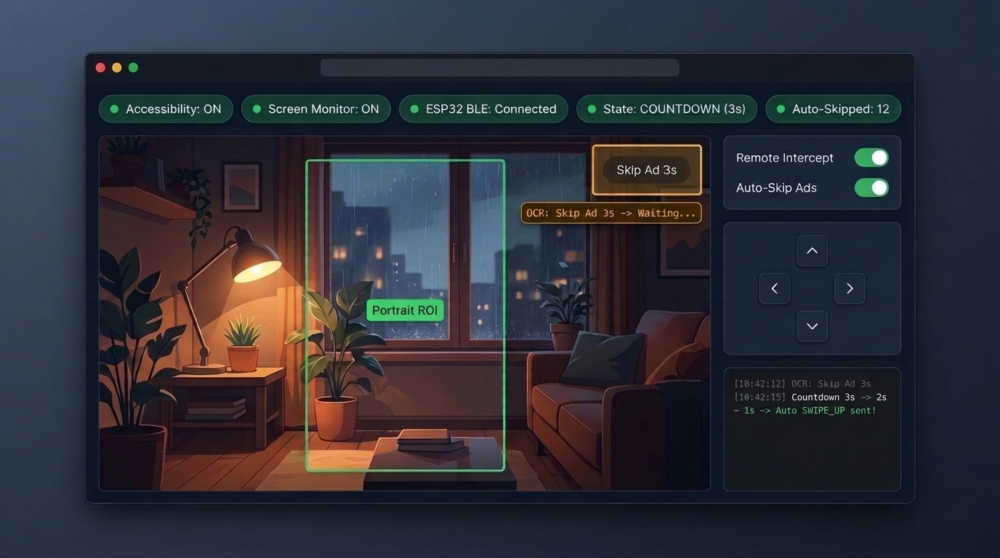

# 📺 TV-Remote-to-iPhone: 用电视遥控器刷 iPhone 短剧，还能看懂读秒自动跳广告！

> **一个用 AI 解决客厅日常小痛点的趣味跨端硬核玩具**  
> *Control iPhone short-video apps with your Android TV remote + on-device OCR auto-skip ads (with countdown timer tracking!) via an ESP32-S3 BLE HID bridge.*



---

## 🎯 折腾的起因：AI 解决日常小麻烦的乐趣

在家把 iPhone 投屏到客厅的 **当贝盒子 H3** 看短剧（比如红果短剧），本来是一件很爽的事，但很快就会遇到两个非常破坏躺平体验的痛点：

1. **翻页还得起身摸手机**：电视遥控器就在手边，却管不了投屏源 iPhone，换一集就得去划一下手机屏幕；
2. **中间动不动插广告，有的还带读秒器**：无读秒的信息流广告要手动划走，带 `5s / 15s` 读秒的广告还得盯着等它倒计时结束再划走。

与其忍着，不如拉着 AI 一起动手造个“客厅小外挂”——**从零到硬件刷机、写安卓盒子 App、联调实机自动跳广告，一上午全部跑通！**

代码本身其实并不复杂，真正好玩的是把 **Android TV 无障碍服务 + 端侧离线 OCR + 局域网 UDP + ESP32-S3 蓝牙 HID 模拟** 串成一条丝滑的自动化链路。

---

## 🧠 整体架构：四端接力



### 核心特性

- **🎮 电视遥控器智能接管（仅投屏时生效）**：通过 Android `AccessibilityService` 实时感知前台窗口，在盒子桌面/设置时完全放行，一旦进入投屏播放画面（如当贝投屏/乐播/AirScreen）自动接管按键：
  - `下键` = 下一集（模拟手指上滑）
  - `上键` = 上一集（模拟手指下滑）
  - `OK / 中键` = 暂停 / 继续播放（双击）
  - `左键` / `右键` = 快退 / 快进（水平左滑 / 右滑并对称回中）
  - `菜单键` = 投屏内临时一键暂停/恢复遥控接管
- **👀 端侧离线 OCR + 双区域（竖屏/横屏）广告识别**：
  - 通过 `MediaProjection` 在后台按需抓取 720p 投屏画面，仅裁剪指定的 ROI 小区域交给 **Google ML Kit 离线中文 OCR**，在 RK3566 盒子上流畅运行、**无需联网、无需谷歌服务**；
  - 同时监控 **竖屏广告区（绿框）** 与 **横屏广告区（橙框）**，刷剧横竖切换无需手动改配置。
- **⏱️ 智能读秒器状态机（防误跳、防连跳）**：
  - **普通广告**：连续确认命中关键词（如 `广告`、`上滑继续观看`）后立刻触发 `SWIPE_UP` 并进入冷却期；
  - **读秒广告**：正则解析剩余秒数（如 `15s` / `5秒` / `00:05`），自动进入 `COUNTDOWN` 状态持续跟踪，等倒计时归零或文案变为可跳过时（附带兜底计时器）再精准切到下一集！
- **🌐 内置浏览器可视化校准面板（`http://<盒子IP>:8088`）**：
  - 电视上用遥控器调坐标太反人类？盒子内置了一个零依赖的轻量 HTTP 服务，用手机或电脑浏览器打开即可看到**实时投屏画面**，直接用鼠标**拖拽框选**竖屏/横屏广告区域，还能微调 iOS 鼠标光标位置、实时看 OCR 识别日志。



---

## 🛠️ 硬件与环境清单

| 角色 | 实测设备 | 说明 |
| :--- | :--- | :--- |
| **安卓电视盒子** | 当贝 DBBOX H3（RK3566 / Android 11） | 运行本项目的 Android TV 控制 App（通用支持 Android 8.0+ 电视盒子） |
| **蓝牙 HID 桥接器** | Waveshare ESP32-S3-Touch-AMOLED-1.75 | 运行 NimBLE 复合 BLE HID（鼠标+键盘）+ UDP 4210 服务（任何 ESP32-S3 开发板均可适配） |
| **被控端** | iPhone（开启「辅助触控」+「执行触控手势」） | 通过 AirPlay / 当贝投屏将画面投到电视盒子 |

---

## 📂 仓库结构

```text
.
├── app/                         # Android TV 控制端 (Kotlin + ML Kit 中文离线 OCR)
│   └── src/main/
│       ├── java/com/jason/dbboxcontroller/
│       │   ├── MainActivity.kt                  # 电视遥控器友好的主界面
│       │   ├── RemoteKeyAccessibilityService.kt # 无障碍全局遥控器按键拦截
│       │   ├── ScreenMonitorService.kt          # MediaProjection 后台定时截屏
│       │   ├── AdDetectorEngine.kt              # 双 ROI 离线 OCR + 读秒状态机
│       │   ├── Esp32Client.kt                   # 局域网 UDP 发现与指令下发
│       │   ├── WebConfigServer.kt               # 内置 :8088 浏览器校准服务
│       │   └── AppConfig.kt                     # ROI 与识别参数持久化
│       └── assets/web/index.html                # 浏览器可视化拖拽框选前端
├── esp32-hid-bridge/            # ESP32-S3 BLE HID + LAN UDP 桥接核心源码 (C++ / ESP-IDF 6.0)
│   ├── ble_hid_controller.h/.cc # NimBLE 鼠标+键盘复合 HID 与对称防漂移滑动
│   ├── lan_hid_server.h/.cc     # 极轻量 UDP 4210 局域网控制服务
│   ├── hid_remote_ui.h/.cc      # 1.75 寸圆屏 LVGL 触控遥控 UI
│   └── README.md                # UDP 协议文档
└── docs/                        # 项目配图与演示素材
```

---

## 🚀 快速上手

### 1. 部署 ESP32-S3 蓝牙 HID 桥接器
将 `esp32-hid-bridge/` 下的文件集成到你的 ESP-IDF（v6.0 + NimBLE）工程中编译烧录，开机后：
1. 在 iPhone 蓝牙中配对 **`Xiaozhi-HID`**；
2. 打开 iPhone **设置 → 辅助功能 → 触控 → 辅助触控**，开启 **「辅助触控」** 与 **「执行触控手势」**；
3. 确保 ESP32-S3 与当贝盒子连在同一个局域网 Wi-Fi 下（ESP32 自动监听 UDP `4210`）。

### 2. 编译并安装当贝盒子控制 App
```bash
# 编译 Debug APK（需安装 JDK 17 与 Android SDK）
./gradlew assembleDebug   # 或使用本地 Gradle 8.9: gradle assembleDebug

# 通过局域网 ADB 推送到当贝 H3（在盒子 设置→关于 连续点击软件版本开启开发者选项与 USB/ADB 调试）
adb connect <盒子IP>:5555
adb install -r app/build/outputs/apk/debug/app-debug.apk

# （可选，强烈推荐）一次性授予永久截屏 + 无障碍自恢复权限，重启盒子后打开 App 自动静默全开
adb shell appops set com.jason.dbboxcontroller PROJECT_MEDIA allow
adb shell pm grant com.jason.dbboxcontroller android.permission.WRITE_SECURE_SETTINGS
```

### 3. 三步启动 & 网页框选校准
1. 在电视上打开 **「iPhone 投屏遥控助手」** → 点击搜索/连接 ESP32 → 开启无障碍服务 → 开启投屏截屏监控；
2. 把 iPhone 投屏到电视并打开视频 App；
3. 用电脑或手机浏览器打开电视右上角显示的 **`http://<盒子IP>:8088`**，直接在真实投屏画面上鼠标拖出绿框（竖屏广告区）和橙框（横屏广告区），保存即生效！

---

## 💡 实机踩坑实录（给后来者的避坑彩蛋）

做硬件 + 跨系统联动最有意思的部分就是踩坑和排雷，这几个坑我们在实机调测时全碰上了：

1. **iOS 辅助触控「灰点只点不拖」玄学 Bug**：蓝牙 HID 频繁重连刷机后，iOS 的「执行触控手势」偶发会卡死成普通鼠标（表现为小灰点移动后只在末尾点一下触发暂停）。**解法**：在 iPhone 设置里把「辅助触控」总开关关掉停 2 秒再重新打开，立刻满血复活。
2. **对称回撤防光标漂移**：iOS 蓝牙鼠标没有绝对坐标，滑动距离过长撞到横屏顶边后，回撤就会把光标推离画面中央。改成 `12 × ±20` 同速对称回撤 + 网页端提供 `← → ↑ ↓` 光标微调按钮，彻底稳住中心点。
3. **ESP32-S3 插着 USB 却 5 分钟黑屏**：AXP2101 电源芯片在电池充到 100% 满电后会停止上报“充电中”，导致原厂 `PowerSaveTimer` 误以为在用电池并在 300 秒后断电关机。禁用自动关机（保留 60 秒降亮度护屏）即可 24 小时稳定在线。
4. **不同网段/路由器拦截 UDP 广播**：部分局域网会过滤 `255.255.255.255` 广播包，因此在保留自动发现的同时，支持在 Web 面板直接指定 ESP32 单播 IP。

---

## 📄 License

本项目采用 [MIT License](LICENSE) 开源。欢迎 Fork 魔改，祝你用 AI 玩得开心、刷剧不看广告！
